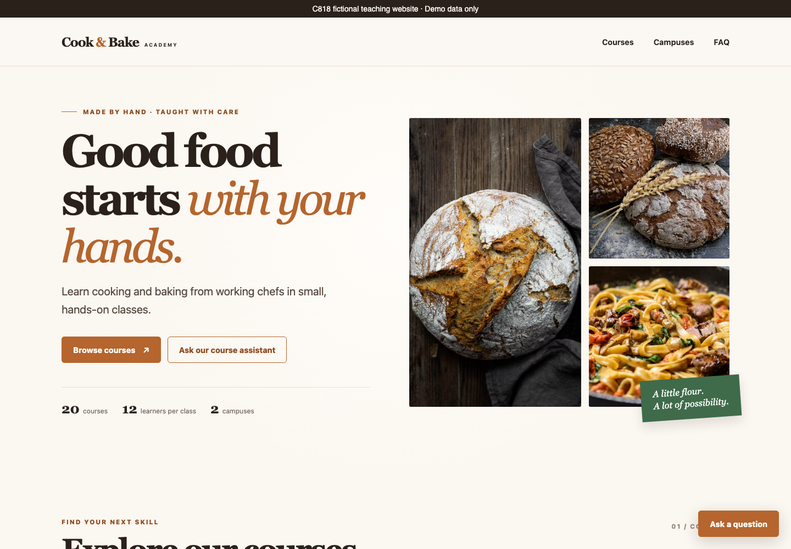
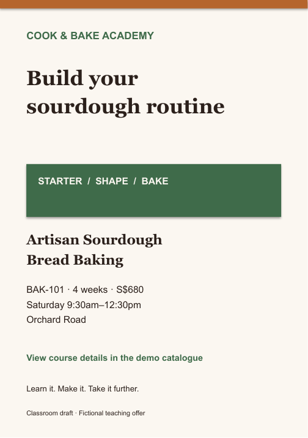
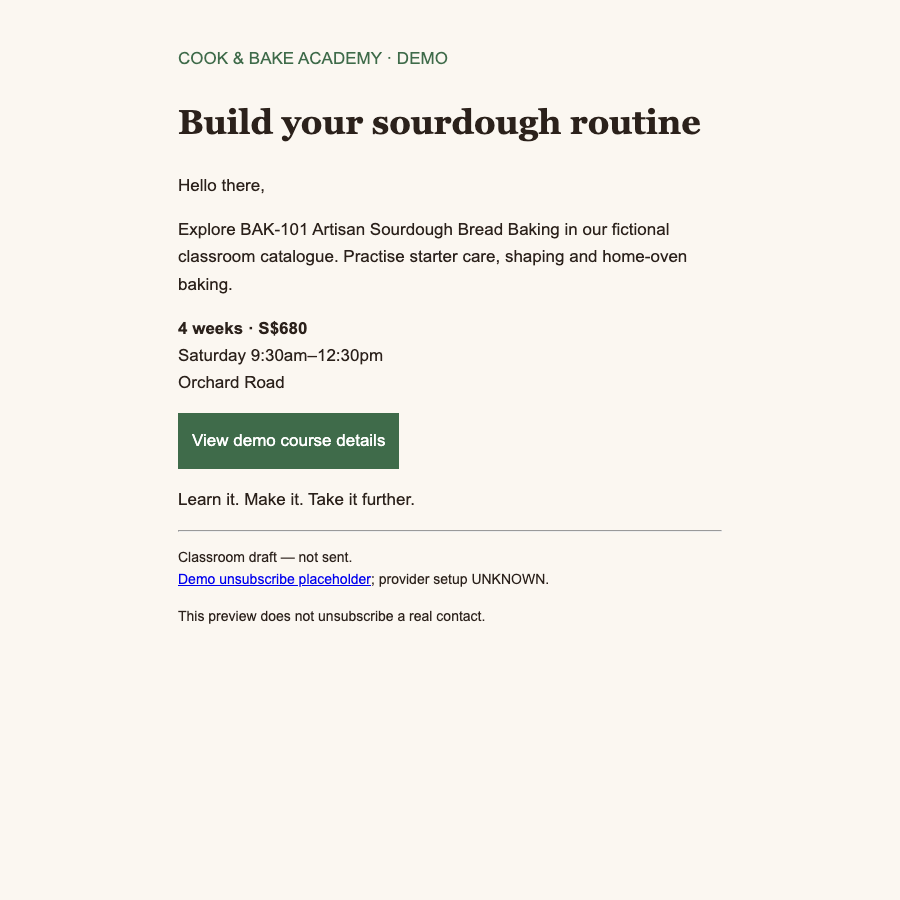

# ChatGPT WORK for Digital Marketing — Learner Guide

C818 · Version 1.0 · 1 October 2026

## Introduction

This guide develops the concepts behind a source-grounded digital marketing workflow and provides complete procedures for eight connected labs. You will create an editable flyer package, social article and content plan, an unsent email campaign and a reviewable handoff. The fictional Cook & Bake Academy website and its catalogue are the shared scenario throughout.

The course is two days with 15 instructional hours. The lesson plan uses 450 instructional minutes plus 30 minutes of tea breaks each day, excluding a 60-minute lunch. Work features depend on account and workspace access. A file-upload route and supplied recovery packs keep the labs usable when local tools or image generation are unavailable.

### Learning outcomes

- LO1: Delegate a grounded marketing task in ChatGPT Work and maintain a source-checked campaign brief.

- LO2: Create and verify editable flyer designs and format variants using the academy brand.

- LO3: Produce useful social articles, platform packages and a coherent content calendar.

- LO4: Prepare a segmented email sequence, interpret synthetic campaign metrics and hand off a reviewable package.

### Tools, access and working folders

Use a ChatGPT account with Work available, a browser, a text editor and a layout editor such as PowerPoint or Google Slides. Python 3 serves the existing teaching website locally. No real subscriber list, connected email account, paid advertising account or API credential is required.

```text
C818-marketing/
  cnbacademy/            # copy from Lab 1 assets
  campaign/              # brief, ledger, metrics, manifest
  creative/sourdough/    # editable flyers and proofs
  content/               # article, post packages, calendar
  email/                 # synthetic segment and unsent sequence
```

On web, add the relevant sources to the project’s Sources section and download the generated files. On desktop, an approved local project can read and write the attached working folder. Ask Work to list the sources it can read before starting. Merely pasting a path does not grant access.

### The reference workflow translated to marketing

| Stage | Marketing meaning | Evidence |
| --- | --- | --- |
| Goal | Audience, offer and one action | brief.md |
| Plan | Compare routes before production | design-decision.md |
| Create | Make the requested editable assets | Source files and proofs |
| Preserve context | Keep brand and source facts available | workflow.md and ledger |
| Version | Identify current deliverables | manifest.csv |
| Prepare distribution | Resolve production settings separately | send-checklist.md |
| Verify | Open and compare saved artifacts | Review logs |

### The shared academy scenario

The existing Cook & Bake Academy site has 20 synthetic courses: 10 Bakery and 10 Cooking. BAK-101 Artisan Sourdough Bread Baking is the sample campaign spine. Its four-week duration, S$680 fee and Saturday schedule are teaching facts. A cafe-business audience angle may be proposed, but no cafe/barista course is verified in this catalogue. Unknown discounts, remaining seats, tax treatment and public booking links must stay UNKNOWN.



## Topic 1 — ChatGPT Work and a grounded brief

Delegate an outcome · control context · verify facts. LO1: Delegate a grounded marketing task in ChatGPT Work and maintain a source-checked campaign brief.

### From conversation to finished work

A short chat is useful for exploring an idea. A work task needs a defined deliverable, source material and a review boundary. Treat the agent as a production collaborator: explain the audience, name the files it may use and describe what a reviewer must be able to verify. A confident draft is not evidence that the source was read.

| Element | Meaning |
| --- | --- |
| Outcome | Campaign brief |
| Evidence | Claim ledger |
| Review | Open both files |

Worked example: For the bakery launch, request a campaign brief plus a claim ledger. The ledger must point each fee, date and duration to a catalogue field. The brief is complete only when both files can be opened.

Common mistake: Do not substitute an attractive response in the chat for the requested downloadable files.

### Choose Chat, Work or Codex

Use Chat for quick exploration, Work for a reviewable deliverable, and Codex when developer views help. On the web, Work uses uploaded or connected sources; a desktop local project can use approved folders. These are different access routes, so ask which files are actually available before drafting. Features depend on the account and workspace.

| Element | Meaning |
| --- | --- |
| Chat | Explore a hook |
| Work | Build campaign files |
| Codex | Inspect code changes |

Worked example: In this course Work drafts and packages the marketing assets. A browser displays the academy catalogue. A local Python server is only a way to preview the provided website.

Common mistake: Do not assume a web project can read a laptop folder, or that a copied path grants file access.

### The seven-stage marketing workflow

The reference build workflow becomes a marketing production loop: define the goal, plan the work, create assets, preserve context, version the outputs, prepare distribution and verify the result. Planning separates choices from execution. Versioning means a reviewer can tell which draft is current. Distribution preparation stops before any live send.

| Element | Meaning |
| --- | --- |
| Goal + plan | Audience and route |
| Create + context | Assets and facts |
| Version + verify | Review package |

Worked example: A learner chooses one catalogue course, reviews a two-route flyer plan, creates one route, records its sources and hands the draft to a reviewer. Each revision retains the course facts.

Common mistake: Do not carry over coding-specific commands or assume hooks publish a campaign.

### A brief is a decision document

A useful brief answers who the message is for, what change is desired, what is being offered, why it matters and what action follows. Audience descriptions should express a need rather than a stereotype. A measurable objective names the event and the time window; target values remain UNKNOWN unless someone has supplied them.

| Element | Meaning |
| --- | --- |
| Audience | Weekend home baker |
| Need | Starter confidence |
| Action | Review course details |

Worked example: For BAK-101, a weekend home baker wants more confidence managing a starter. The proposed action is to review course details. Bookings, paid spend and sales targets are UNKNOWN in the teaching scenario.

Common mistake: A generic objective such as increase awareness cannot guide a single flyer or its verification.

### Build a claim ledger

A claim ledger distinguishes a source fact, a creative proposal and an unknown. Store the exact field or source location, not only a vague filename. Creative language can explain value but must not change the offer. Dates and prices are copied from the selected record and checked against the website.

| Element | Meaning |
| --- | --- |
| Fact | fee = 680 |
| Proposal | Bake with confidence |
| Unknown | Seats remaining |

Worked example: BAK-101 has fee 680, weeks 4 and campus Orchard Road in data/courses.json. Record them as scenario facts. A proposed headline is creative copy. Seats remaining is UNKNOWN; class_size 12 is a capacity, not an availability count.

Common mistake: Never turn a capacity into scarcity or a published fee into a discount.

### Context has layers

Persistent project guidance carries brand and working rules. Source files carry catalogue facts. The current prompt carries the particular task. Separate those layers so a changed campaign does not silently rewrite brand rules. A small, relevant source pack is easier to review than a large folder of unrelated drafts.

| Element | Meaning |
| --- | --- |
| Rules | Brand voice |
| Sources | Catalogue record |
| Task | One campaign |

Worked example: The project contains brand.md, market-brief.md and courses.json. The task selects BAK-101 and asks for an A5 flyer. Past social drafts can guide voice, but cannot supply new dates.

Common mistake: Do not let a previous generated draft become the authority for course facts.

### Outcome, sources, constraints, checks

A production prompt states the artifact, permitted sources, limitations and observable checks. Ask for a short plan before production when several formats are involved. Precise feedback names the changed element and the facts that must remain fixed. This controls drift better than repeatedly asking for a nicer result.

| Element | Meaning |
| --- | --- |
| Outcome | Editable flyer |
| Constraints | Approved facts only |
| Checks | Text proof + sources |

Worked example: Create an A5 flyer for BAK-101 using the catalogue and brand files. Keep all factual copy editable. Return a text proof and source ledger. Stop before publishing.

Common mistake: More detail is not always better: contradictory instructions can make the deliverable impossible.

### Handle missing information visibly

UNKNOWN is a useful production state. It prevents an unsupported detail from acquiring authority through repetition. Maintain an issues list with an owner and a next action. A proposed idea should be labelled as a proposal even when it sounds plausible.

| Element | Meaning |
| --- | --- |
| Know | Catalogue facts |
| Propose | Audience angle |
| Hold | Unsupported offer |

Worked example: A cafe-owner audience angle is a proposal supported by baking relevance. A barista syllabus, voucher offer and live booking URL are absent from the catalogue and remain UNKNOWN.

Common mistake: Do not invent missing contact information just to fill a flyer footer.

### Files and plugins have boundaries

Work can use files and installed plugins, but availability and permissions vary. Grant only the context needed for the task. For class, use the supplied synthetic files and local previews. A production email tool needs a verified account, approved audience and reviewed send settings; drafting an email never authorizes sending it.

| Element | Meaning |
| --- | --- |
| Read | Synthetic sources |
| Write | Draft assets |
| Send | Separate approval |

Worked example: If no email plugin is installed, Work still produces the sequence, HTML preview and handoff manifest as files. A marketer can import them later into an approved platform.

Common mistake: Do not paste account credentials into a prompt or include private subscriber exports.

### Review the actual artifact

Verification happens in the saved file, not only in the agent summary. Open the artifact, compare it to the brief and inspect each critical fact. Keep a review log that records the problem, correction and evidence. The person reviewing must be able to reproduce the check.

| Element | Meaning |
| --- | --- |
| Open | Saved file |
| Compare | Brief + sources |
| Record | Correction log |

Worked example: The brief says BAK-101 is four weeks. Open the flyer PDF and social article to confirm both say four weeks, then compare against the selected catalogue record.

Common mistake: An agent saying checked everything is not a substitute for a readable proof.

### Reuse the academy website

The existing Cook & Bake Academy catalogue is the shared scenario. It has 20 synthetic courses, with 10 Bakery and 10 Cooking entries. The site separates data from presentation so fees and schedules can be compared directly with the JSON. A cafe-business angle may draw on bakery skills, but the catalogue contains no verified cafe training programme.

| Element | Meaning |
| --- | --- |
| Website | Original catalogue |
| Data | 20 course records |
| Campaign | BAK-101 |

Worked example: Use Artisan Sourdough Bread Baking as the campaign spine. Keep the academy identity, existing site and original course code across the flyer, article and email.

Common mistake: Do not rename the academy or add a cafe course to make the scenario appear more complete.

### Checkpoint: one source of truth

At the first checkpoint, a learner should have a campaign brief, selected course record, claim ledger and list of unknowns. These files become the input to every later lab. A recovery pack allows a learner who missed setup to rejoin without borrowing another learner’s generated files.

| Element | Meaning |
| --- | --- |
| Brief | Audience + objective |
| Ledger | Field-level evidence |
| Handoff | Same code everywhere |

Worked example: The supplied checkpoint chooses BAK-101 and keeps discounts, real registration links and remaining seats UNKNOWN. Later assets inherit that boundary.

Common mistake: Do not proceed with conflicting course codes across the brief and ledger.

### Lab 01 — Create a grounded campaign brief

Duration: 45 minutes. Learning outcome: LO1.

Goal: Produce a source-checked campaign brief for one bakery course.

What you will build: campaign/brief.md, campaign/selected-course.json, campaign/claim-ledger.csv and campaign/unknowns.md. These define the facts used by every later asset.

Prerequisites: A ChatGPT account with Work available, a browser and a text editor. Python 3 is needed only for the local website preview. Use the upload route if local folder access is unavailable.

#### Detailed procedure

1. Prepare your working copy. Create a folder named C818-marketing on your computer. Copy assets/cnbacademy from this lab into it. Create a campaign folder beside cnbacademy. Do not work in the original reference folder.

2. Start the website. In a terminal opened inside C818-marketing/cnbacademy, run python3 -m http.server 8080. Keep it running and open http://localhost:8080 in a browser. Search the course catalogue for sourdough. Confirm BAK-101 is visible. If Python is unavailable, read data/courses.json directly and use the included site screenshot in the guide.

3. Inspect the sources. Open cnbacademy/brand.md, cnbacademy/market-brief.md and cnbacademy/data/courses.json. Locate BAK-101. Record the title, fee, weeks, when, campus, intakes, allergens and learning outcomes. These are fictional scenario facts, not real offers.

4. Choose the access route. On ChatGPT web, create a project named C818 Marketing and add the brand, market brief and catalogue through Sources. On desktop, open Projects, create or edit a local project and attach C818-marketing using Add folder. In a new task select ChatGPT and switch to Work. If Work is unavailable, continue with the supplied checkpoint files and record the feature limitation.

5. Set durable guidance. Add the text in assets/project-instructions.md to project instructions, or attach it as a source when the instruction editor is unavailable. Ask Work to list the sources it can actually read before continuing. A path alone does not prove access.

6. Request the brief. Copy prompts/task.txt into the Work task. Ask for the short plan first. Check that the plan uses only BAK-101, labels unknowns and returns the four named files. Reply: Proceed with this plan; keep all outputs as classroom drafts.

7. Review the ledger. Open claim-ledger.csv. Compare each fee, duration, schedule and location against the BAK-101 record. Add a row for remaining seats with status UNKNOWN. Confirm that class_size 12 was not treated as twelve available seats.

8. Save and checkpoint. Download the four artifacts into C818-marketing/campaign, or confirm them on disk in the local route. Open each file. Record any corrections in unknowns.md. Keep these files for Lab 2. If the task stalled, copy this lab’s checkpoints files into campaign and label them supplied sample drafts.

#### Copy-ready task prompt

```text
Use the attached Cook & Bake Academy brand.md, market-brief.md and data/courses.json. Create a campaign brief for BAK-101 Artisan Sourdough Bread Baking aimed at weekend home bakers, with a secondary proposed cafe-business audience angle. Use no other fact sources. First propose a short plan; wait for my review before drafting.
After I approve the plan, return four files: brief.md (audience need, objective, message, CTA, scope and draft status), selected-course.json (the exact BAK-101 record), claim-ledger.csv (claim,value,source_field,status) and unknowns.md (unknown,impact,next_action). Copy source facts exactly. Record remaining seats, discounts, tax treatment, public booking link, campaign performance and sales target as UNKNOWN. A class capacity is not seats remaining. Do not add a cafe course. Do not publish, post or send anything.
```

#### Test it

- The saved selected-course.json has code BAK-101, fee 680, weeks 4 and campus Orchard Road.

- The brief identifies one audience need and one primary CTA.

- Every offer fact has a source_field; missing details are UNKNOWN.

- All four files open and are labelled classroom draft.

#### Troubleshooting

Work cannot find local files: Use the project Sources upload route; attach the exact three files, then ask for the visible source list again.

The website is blank or courses do not load: Serve from the cnbacademy folder, not its parent, and use http://localhost:8080 rather than file://. Use port 8081 if 8080 is occupied.

Work invents an offer: Name the unsupported sentence, request its removal and compare the regenerated ledger with the catalogue.

#### Challenge

Repeat the brief for BAK-107, keeping a separate folder and ledger so its three-week duration cannot leak into the BAK-101 campaign.

#### Reflection

Which facts came from the catalogue, and which parts of your brief are proposals?

Recovery checkpoint: labs/lab-01-grounded-campaign-brief/checkpoints/. Supplied files are sample classroom drafts. Record sample provenance and verify the facts before continuing. Each lab has its own README, assets and prompts in labs/lab-01-grounded-campaign-brief/ .

### Lab 02 — Build a reusable marketing workflow

Duration: 50 minutes. Learning outcome: LO1.

Goal: Create and trial a source-grounded production playbook for the campaign.

What you will build: campaign/workflow.md, campaign/brand-check.md and campaign/workflow-trial.md. The playbook carries the same rules into flyer, social and email production.

Prerequisites: Lab 1 campaign files. This lab includes adapted brand-voice, flyer-design and social-post skill examples. They are reading resources until installed and enabled.

#### Detailed procedure

1. Gather the current context. Open the Lab 1 brief and claim ledger. Copy assets/skills into C818-marketing/skills-examples so the brand and creative workflow examples remain together. Read brand-voice/SKILL.md before flyer-design/SKILL.md and social-post/SKILL.md.

2. Translate the reference workflow. Write the seven stages in campaign/workflow.md: goal, plan, create, preserve context, version, prepare distribution and verify. For each stage name an input, output and check. Do not copy terminal-specific Claude commands into the Work task.

3. Resolve the fact-source paths. In your working copy, resolve data/courses.json to cnbacademy/data/courses.json. The optional campaign/term-highlights.md is absent, so instruct Work to use the catalogue only. Do not create promotional facts just to satisfy a skill reference.

4. Draft the reusable playbook. Attach the example skill files, brief and ledger to Work. Paste prompts/task.txt. Review the returned workflow and brand checklist. Check the exact tagline Learn it. Make it. Take it further.

5. Choose a supported reuse route. The guaranteed classroom route is to add workflow.md to project Sources and cite it in each task. If skill creation is available, select @skill-creator in ChatGPT, ask it to package the reviewed workflow as a skill, then enable the resulting skill. Use its displayed name through an @ mention in a new task. Installation is optional; merely uploading SKILL.md does not enable automatic discovery.

6. Run a small trial. Ask Work: Using workflow.md and the BAK-101 source record, produce a 60-word course introduction and a claim ledger, then stop for review. Save the result as workflow-trial.md. No image generation or connected email tool is needed.

7. Inspect the trial. Check the trial for unsupported urgency, discounts, invented chef names and changed dates. Confirm the practical voice and exact course title. Record at least one specific improvement in brand-check.md, even if it is a wording choice.

8. Save the checkpoint. Keep workflow.md and brand-check.md with the Lab 1 campaign files. Record whether you used Sources or an enabled skill. If setup stalled, copy checkpoints/workflow.md and trial it using the source-upload route.

#### Copy-ready task prompt

```text
Review the attached brand-voice, flyer-design and social-post workflow examples. Adapt them into one ChatGPT Work marketing playbook for the C818 classroom campaign. Use the BAK-101 brief and catalogue as the only offer facts. Return workflow.md with the seven-stage process, named inputs/outputs, fact checks, format rules and a stop-before-distribution boundary. Return brand-check.md covering the exact tagline, practical voice, palette, editable copy, alt text and unsupported claims. Explain how to reuse the file through project Sources; do not claim that a file is an enabled skill unless it was actually installed. Preserve UNKNOWN for absent campaign facts.
```

#### Test it

- workflow.md has seven named stages with inputs, outputs and checks.

- The tagline and academy palette match the supplied brand examples.

- The trial has no invented discounts, chef names or seat availability.

- The reuse route is recorded accurately: uploaded source or installed skill.

#### Troubleshooting

The @ skill name does not appear: Use workflow.md as an uploaded source; do not claim automatic skill invocation.

A source path is broken: Point the task to cnbacademy/data/courses.json and remove the absent term-highlights source.

The trial sounds generic: Ask for one practical learner benefit from the exact learning outcomes, and remove unsupported superlatives.

#### Challenge

Create an email-only workflow extension that requires an audience rule, plain-text version, review log and a separate send approval.

#### Reflection

What did the reusable workflow prevent that a one-off prompt might miss?

Recovery checkpoint: labs/lab-02-reusable-marketing-workflow/checkpoints/. Supplied files are sample classroom drafts. Record sample provenance and verify the facts before continuing. Each lab has its own README, assets and prompts in labs/lab-02-reusable-marketing-workflow/ .

### Topic 1 recap — LO1

Explain the first concept in your own words, open the current lab output and show the evidence for its factual claims. Name one revision and the next check another marketer can reproduce. LO1: Delegate a grounded marketing task in ChatGPT Work and maintain a source-checked campaign brief.

## Topic 2 — Flyer design and visual review

Hierarchy · evidence · editable typography. LO2: Create and verify editable flyer designs and format variants using the academy brand.

### Design begins with a single job

A flyer has a small amount of attention to earn. Choose one audience and one action before arranging copy. The headline expresses the learner benefit; supporting facts reduce uncertainty; the call to action tells the reader what to do next. Every element should serve that job.

| Element | Meaning |
| --- | --- |
| Headline | Learning benefit |
| Evidence | Offer facts |
| CTA | Next action |

Worked example: For BAK-101, the main benefit is learning to manage a starter and bake loaves. Four weeks, fee and schedule are supporting facts. The CTA points to course details in the demo catalogue.

Common mistake: Do not combine three courses, two offers and several competing CTAs in the first flyer.

### Visual hierarchy controls reading

Hierarchy uses size, placement and contrast to establish reading order. A headline is dominant, followed by the course identity and essential details, then the CTA. White space groups related information and keeps the composition calm. A photograph should support the message without making text harder to read.

| Element | Meaning |
| --- | --- |
| First | Benefit headline |
| Second | Course details |
| Third | CTA + context |

Worked example: A natural-light bread image occupies one region while course facts sit on a cream panel. The headline is readable before the fee; the CTA has a clear boundary.

Common mistake: If every line is bold and large, the eye has no route through the page.

### Brand system versus deck theme

The trainer deck follows the supplied terracotta, charcoal and cream reference theme. The marketing assets follow Cook & Bake’s own Crust, Ink, Cream and Basil colours with Georgia headings. These are different design systems serving different audiences. Consistency means using the correct system in each artifact.

| Element | Meaning |
| --- | --- |
| Crust | #B5652D |
| Ink | #2B211B |
| Cream | #FBF7F1 |

Worked example: A cream academy flyer uses #B5652D as its accent and #2B211B for text. A classroom diagram uses the reference deck’s #D97757 accent.

Common mistake: Do not copy the trainer-slide palette into the academy campaign simply because it looks similar.

### Separate the visual from the copy

Image generation is useful for food imagery and composition studies. Exact prices, dates and long copy are easier to verify when they remain editable in a layout tool. Treat generated artwork as illustrative, not evidence of a real class. Keep the image prompt and text proof beside the design.

| Element | Meaning |
| --- | --- |
| Image | Illustrative food |
| Copy | Editable facts |
| Proof | Every visible word |

Worked example: Generate a natural-light sourdough still life without lettering, then place the course title, source-checked fee and CTA in editable text boxes.

Common mistake: Do not use a photorealistic invented chef or classroom as proof of a real trainer or learner.

### Format is part of the brief

Print and screen formats have different viewing conditions. An A5 portrait layout measures 148 by 210 mm. Social derivatives can use a square or portrait layout chosen for the brief. Recompose rather than crop essential information. A printer’s bleed requirement must be confirmed instead of assumed.

| Element | Meaning |
| --- | --- |
| A5 | 148 × 210 mm |
| Square | 1080 × 1080 brief |
| Story | 1080 × 1920 brief |

Worked example: The classroom flyer uses a 10 mm safe area. Its square derivative carries the same core facts but reduces secondary copy so the CTA remains readable.

Common mistake: A square screenshot of an A5 flyer is usually a poor social layout.

### Readable contrast and typography

Text must remain readable against its background. WCAG’s minimum contrast guidance uses 4.5:1 for normal text and 3:1 for qualifying large text. These are a useful screen-design check, not a guarantee of print quality. Inspect the actual asset at a practical size as well.

| Element | Meaning |
| --- | --- |
| Body text | 4.5:1 screen check |
| Large text | 3:1 screen check |
| Real size | Read the proof |

Worked example: Use dark Ink on Cream for body copy. Avoid fine terracotta lettering over bread texture. Check the CTA at phone size and the print proof at 100 percent.

Common mistake: Do not judge contrast from the colour name or from a zoomed-in editor view alone.

### Every factual line needs a source

A flyer may contain very few words, but each fee, date and location carries risk of being copied incorrectly. Transcribe all visible text and map every factual line back to the selected record. Creative headlines still need to avoid unsupported promises.

| Element | Meaning |
| --- | --- |
| Text proof | Visible words |
| Ledger | Source fields |
| Revision | Named correction |

Worked example: The phrase four-week course maps to weeks = 4. S$680 maps to fee = 680. Saturday 9:30am–12:30pm maps to when. Tax treatment is UNKNOWN in the fictional catalogue.

Common mistake: Do not add all-inclusive or guaranteed success unless an approved source supports it.

### Use two routes, then choose

A route is a different design approach to the same brief, not a random variation in facts. Compare routes against the audience, hierarchy and readability. Choose one route before spending time on production details. The rejected route can remain in the review notes as an explanation of the decision.

| Element | Meaning |
| --- | --- |
| Route A | Finished loaf |
| Route B | Hands at work |
| Decision | Audience + clarity |

Worked example: Route A leads with a finished loaf and practical benefit. Route B leads with hands shaping dough. Both carry the same course code, fee, duration and CTA.

Common mistake: Changing the offer between routes makes the comparison meaningless.

### Revise with a bounded instruction

Good feedback says what to change, why and what must remain fixed. A narrow correction reduces accidental changes to already verified facts. After revision, compare the full proof again because a small layout change can hide text or alter reading order.

| Element | Meaning |
| --- | --- |
| Change | One layout issue |
| Preserve | Verified facts |
| Recheck | Complete proof |

Worked example: Move the fee to the details panel and increase body text size. Preserve the course title, four-week duration, schedule, brand colours and tagline exactly.

Common mistake: Do not accept a corrected date while overlooking a new spelling error elsewhere.

### QR codes and links must be real

A QR code is a navigation mechanism, not decoration. A generated imitation can look convincing but lead nowhere. Use only a verified destination; otherwise use an explicitly labelled placeholder or omit the code. The demo local website is not a public booking destination.

| Element | Meaning |
| --- | --- |
| Destination | Verified URL |
| Code | Test by scanning |
| Unknown | Omit or label |

Worked example: The classroom flyer labels its action View course details in the demo catalogue. Its link goes to the provided local preview. No real registration promise is made.

Common mistake: Do not make a placeholder look like a working public booking code.

### Quality review is a comparison

A useful review compares the artifact with a specific criterion and records evidence. It checks hierarchy, factual accuracy, brand voice, mobile readability and missing information separately. A polished visual can fail the fact check even when it succeeds aesthetically.

| Element | Meaning |
| --- | --- |
| Visual | Hierarchy + crop |
| Factual | Ledger comparison |
| Usability | Actual-size reading |

Worked example: A review row records fee visible in PDF, source fee = 680, and accepted or revise. A second row checks the CTA at phone size.

Common mistake: Avoid an overall looks good note that does not show what was checked.

### Checkpoint: three usable formats

The flyer checkpoint contains the editable A5 source, PDF proof, square derivative, story derivative, generation prompt if used and text proof. Keep a manifest that gives each file’s purpose and status. All formats carry the same course identity and none is a live advertisement.

| Element | Meaning |
| --- | --- |
| Editable | A5 source |
| Portable | PDF proof |
| Derivative | Square + story |

Worked example: The sample checkpoint is a typographic classroom layout. Learners can replace the visual with an approved image while preserving the factual text and source ledger.

Common mistake: Do not hand off only flattened screenshots when an editable design was requested.



### Lab 03 — Design an editable bakery flyer

Duration: 75 minutes. Learning outcome: LO2.

Goal: Create an A5 flyer with source-checked copy and a complete text proof.

What you will build: creative/sourdough/flyer-a5.pptx or another editable layout source, flyer-a5.pdf, flyer-copy.md, image-prompt.txt and text-proof.md.

Prerequisites: Labs 1–2. PowerPoint, Google Slides or another layout editor with PDF export. Optional ChatGPT image generation; the supplied typographic checkpoint supports accounts without image generation.

#### Detailed procedure

1. Prepare the asset folder. Create creative/sourdough inside C818-marketing. Copy this lab’s assets/design-brief.md into it. Keep the selected course and ledger attached to the Work task.

2. Plan two visual routes. Paste prompts/task.txt into Work. Review the two proposed routes before production: finished loaf and hands at work. Choose one route and explain the decision in creative/sourdough/design-decision.md.

3. Approve the exact copy. Ask Work to save flyer-copy.md with the title, four-week duration, S$680 scenario fee, Saturday schedule, Orchard Road campus, CTA and tagline. Compare each factual line with selected-course.json. Omit tax claims, discounts and remaining seats.

4. Create or choose the visual. If image generation is available, request an original natural-light sourdough image with no text, faces, chef identities or logos. Save the exact prompt as image-prompt.txt and the image as sourdough-visual.png. If unavailable, use the typographic checkpoint and record no generated image used.

5. Create the editable layout. Ask Work to create an editable A5 portrait flyer, or open PowerPoint and set Design > Slide Size > Custom Slide Size to width 14.8 cm and height 21 cm. In Google Slides use File > Page setup > Custom with the same dimensions. Use Georgia headings, a sans-serif body and the academy palette. Keep important text at least 10 mm from the trim edge.

6. Place facts as live text. Use text boxes for every factual line rather than relying on lettering inside the generated image. Keep one primary CTA: View course details in the demo catalogue. Add classroom draft wording in a small but readable footer. Do not insert a fake QR code or a made-up public registration URL.

7. Export and proof. Save the editable source and export PDF. Open the PDF at 100 percent. Transcribe every visible word and number into text-proof.md, including the footer. Beside each offer fact record the source field.

8. Request a bounded correction. Attach the proof and PDF to Work. Ask it to find factual, hierarchy or readability problems. Choose one specific correction, preserve the verified facts, export again and update the proof.

9. Save the checkpoint. Keep the editable source, PDF, copy, proof and prompt together. If the task stalled, use checkpoints/flyer-a5.pptx and its PDF as a classroom starting point and revise it against your own brief.

#### Copy-ready task prompt

```text
Using workflow.md, brand.md, selected-course.json and claim-ledger.csv, plan two A5 portrait flyer routes for Cook & Bake Academy BAK-101. Explain the hierarchy, image choice and CTA for each, then wait for my choice. After the choice, produce editable flyer copy and an editable layout file if your tools support it. Use the academy brand, not the trainer deck palette. Exact tagline: Learn it. Make it. Take it further. Keep all factual text editable, add a readable classroom draft footer and return a full text proof with source fields. Use no discount, seat scarcity, invented trainer or real booking promise. Generate imagery only if available and keep its prompt. Stop before publishing.
```

#### Test it

- The A5 page is 148 × 210 mm and essential text stays inside a 10 mm safe area.

- Title, fee, duration, schedule and campus match the selected record.

- The saved PDF is readable at 100 percent and has one CTA.

- An editable source and complete visible-text proof exist.

#### Troubleshooting

Generated image text is misspelled: Generate the visual without text and use editable text boxes for all copy.

The facts crowd the layout: Remove nonessential prose before reducing body text; preserve the required offer facts and CTA.

No image tool is available: Use the included typographic checkpoint and record the limitation; the output still needs an editable source and proof.

#### Challenge

Create a second flyer for the career-changer audience without altering the course facts; explain the changed benefit emphasis.

#### Reflection

How did hierarchy make the primary action easier to find?

Recovery checkpoint: labs/lab-03-flyer-design/checkpoints/. Supplied files are sample classroom drafts. Record sample provenance and verify the facts before continuing. Each lab has its own README, assets and prompts in labs/lab-03-flyer-design/ .

### Lab 04 — Adapt and review the flyer variants

Duration: 55 minutes. Learning outcome: LO2.

Goal: Produce square and story derivatives that retain the offer and remain readable.

What you will build: creative/sourdough/flyer-square.pptx, flyer-story.pptx, their PDF or PNG proofs, variants-proof.md and design-review.csv.

Prerequisites: Lab 3 A5 source and text proof. A layout editor and a browser or image viewer.

#### Detailed procedure

1. Inspect the A5 proof. Open flyer-a5.pdf and flyer-copy.md. List the facts that must survive in each derivative: course identity, duration, fee, schedule, campus and one CTA. If Lab 3 stalled, use its checkpoint source.

2. Create separate canvases. In your layout editor create a 1:1 square canvas and a 9:16 story canvas. For editable PowerPoint use custom sizes 20 × 20 cm and 18 × 32 cm. Export raster images at 1080 × 1080 and 1080 × 1920 when the tool supports exact pixels; otherwise use PDFs and record their aspect ratio.

3. Request adaptation. Attach the A5 source or PDF, copy and ledger to Work, then paste prompts/task.txt. Ask for recomposition rather than cropping. Keep the academy colour and type rules.

4. Recompose the square. Put the headline and course title near the top, use a short details block, and give the CTA its own region. Do not shrink the whole A5 page to a square screenshot.

5. Recompose the story. Keep key information clear of the top and bottom interface zones. Use a conservative 10 percent top and bottom content margin for this classroom brief. Preserve a readable course identity and CTA.

6. Inspect at practical sizes. Open the square at thumbnail size and the story at a phone-width view. Read every factual line. Check text contrast; for normal screen text use 4.5:1 and for qualifying large text use 3:1 as the minimum check. Record the colour pair and tool/method used in design-review.csv.

7. Proof both variants. Transcribe all visible text for each format into variants-proof.md. Compare it with the A5 proof and selected-course.json. Record exact file names and any corrected line.

8. Export and hand off. Save editable sources and proofs in creative/sourdough. Fill assets/design-review-template.csv with at least six concrete checks and a status for each. Resolve every factual defect before proceeding to Lab 5.

#### Copy-ready task prompt

```text
Adapt the reviewed A5 flyer to a square and 9:16 story format. Recompose the content for each format; preserve the BAK-101 identity, source-checked offer and academy brand. Keep one CTA and readable classroom draft wording. Return editable sources when supported, PDF or PNG proofs, a full text transcription for both variants and a review log covering source fidelity, crop, hierarchy and readability. Use no fake QR code, new offer or live booking promise.
```

#### Test it

- Square and story have the requested aspect ratios, with essential text visible.

- Both variants match BAK-101’s title, S$680 fee and four-week duration.

- The story’s key text is outside the classroom top/bottom margin zones.

- design-review.csv records at least six reproducible checks and corrections.

#### Troubleshooting

The story crops the CTA: Reposition the CTA within the centre content area; do not rely on automatic fit.

Exported pixels differ: Use a supported image export or keep an aspect-correct PDF and note the pixel-export limitation.

A variant changes a fact: Copy the approved factual text block again, export and recheck the entire transcription.

#### Challenge

Create an accessible text-only companion that contains the offer and action for someone who cannot view the graphic.

#### Reflection

Which elements needed recomposition rather than simple resizing?

Recovery checkpoint: labs/lab-04-flyer-variants-and-review/checkpoints/. Supplied files are sample classroom drafts. Record sample provenance and verify the facts before continuing. Each lab has its own README, assets and prompts in labs/lab-04-flyer-variants-and-review/ .

### Topic 2 recap — LO2

Explain the first concept in your own words, open the current lab output and show the evidence for its factual claims. Name one revision and the next check another marketer can reproduce. LO2: Create and verify editable flyer designs and format variants using the academy brand.

## Topic 3 — Social articles and content planning

Useful teaching angles · adaptation · calendar. LO3: Produce useful social articles, platform packages and a coherent content calendar.

### A social article has a useful promise

A social article develops an idea beyond a short caption. Begin with the reader’s problem, explain a practical perspective and connect it to a relevant course without making the piece a long advertisement. Separate culinary guidance that needs expert review from catalogue facts.

| Element | Meaning |
| --- | --- |
| Problem | Starter uncertainty |
| Idea | Learn a repeatable process |
| Evidence | Catalogue outcomes |

Worked example: An article about building starter confidence explains what a beginner should look for in a structured class. It uses BAK-101’s learning outcomes as evidence without inventing a recipe.

Common mistake: Avoid presenting unverified food-safety or fermentation instructions as authoritative advice.

### Choose a content pillar

A content pillar is a repeatable area of value for an audience. For the academy, useful pillars include skill confidence, process and preparation, course discovery and learner questions. Pillars prevent a calendar from becoming repeated sales copy. They must still serve the campaign objective.

| Element | Meaning |
| --- | --- |
| Teach | Skill confidence |
| Show | Process + preparation |
| Invite | Course discovery |

Worked example: The first article focuses on confidence. A second post explains what to bring. A course-discovery post introduces the selected course using the exact catalogue fields.

Common mistake: A pillar called engagement is too vague to help a writer choose an angle.

### Use a hook without inventing a result

A hook makes the reader want to continue. It can name a familiar problem or a useful question. It should not create a guarantee, fake scarcity or an invented learner testimonial. Test whether the body actually fulfils the hook’s promise.

| Element | Meaning |
| --- | --- |
| Hook | Recognisable problem |
| Body | Useful explanation |
| CTA | Relevant next step |

Worked example: Your starter needs a routine, not guesswork is a creative hook. Become an expert in four weeks overstates the course’s outcomes and should be rejected.

Common mistake: Clickbait creates attention that the article cannot justify.

### Structure a self-contained article

An article needs an opening, a developed middle and a conclusion with one next action. Each section should advance the idea. Keep catalogue facts in a clearly sourced block and distinguish advice from the offer. Use headings so readers can scan before deciding to read fully.

| Element | Meaning |
| --- | --- |
| Opening | Name the need |
| Middle | Explain the idea |
| Ending | One next action |

Worked example: A 500–700 word classroom article has three sections: the beginner’s problem, the learning process and what the selected class covers. Its final CTA points to course details.

Common mistake: Do not pad the article with repeated AI phrases or unsupported claims to hit a word count.

### Repurpose the idea, not the paragraph

Repurposing retains the central promise and source facts while changing the format. A short caption may foreground one useful insight; a carousel divides the idea into discrete panels; a long article provides context. Each format needs its own reading rhythm and one CTA.

| Element | Meaning |
| --- | --- |
| Article | Develop the idea |
| Caption | One useful insight |
| Carousel | Panel sequence |

Worked example: Turn the article into an Instagram caption under 120 words and a Facebook post. Both keep the BAK-101 course title and avoid copying the full article opening.

Common mistake: Pasting the same long paragraph everywhere ignores how people read each format.

### Voice is a set of choices

The academy voice is warm, practical and confident. Prefer concrete actions and short sentences. The exact tagline is Learn it. Make it. Take it further. Brand voice can vary slightly by format without changing factual meaning. Remove hype that substitutes for evidence.

| Element | Meaning |
| --- | --- |
| Warm | Helpful language |
| Practical | Concrete action |
| Confident | Supported claims |

Worked example: Learn to feed and maintain a starter is grounded in the course outcomes. Unlock your limitless culinary potential is vague and inconsistent with the brand.

Common mistake: A casual voice does not justify exaggeration or invented personal experience.

### Alt text describes the actual visual

Alt text conveys the meaningful content of an image to someone who cannot see it. Describe the actual image and its role. Avoid claiming a photo shows a real learner, trainer or venue unless that is verified. Proposed alt text is provisional until the chosen asset exists.

| Element | Meaning |
| --- | --- |
| Observe | Actual contents |
| Describe | Relevant meaning |
| Verify | No invented identity |

Worked example: For an illustrative loaf image: A sliced sourdough loaf on a cream work surface, with its crumb visible. A flyer’s essential offer should also appear in nearby text.

Common mistake: Do not use alt text as a pile of keywords or describe an image that was never generated.

### A calendar is a coordination tool

A content calendar records the message, format, audience, source, owner and review status. Relative day labels avoid implying a real scheduled launch. Dependencies show which assets must be ready first. A calendar should help a team produce and review, not merely assign dates.

| Element | Meaning |
| --- | --- |
| Plan | Relative day |
| Produce | Named asset |
| Review | Owner + status |

Worked example: Day 1 introduces the article, Day 3 shares a preparation caption, Day 5 uses the flyer. Each row identifies BAK-101 and points to the same claim ledger.

Common mistake: A proposed calendar is not proof that posts are scheduled or published.

### Balance teaching and promotion

The reused academy social workflow limits hard-sell posts to one in five. This is a classroom brand rule rather than a universal algorithm rule. Educational and preparation posts can still support the campaign by helping the reader make a decision. Keep promotional status explicit in the calendar.

| Element | Meaning |
| --- | --- |
| 3 posts | Teach a useful idea |
| 1 post | Answer a question |
| 1 post | Direct invitation |

Worked example: A five-post set uses three teaching angles, one practical question and one direct course invitation. All five have a clear purpose and appropriate CTA.

Common mistake: Do not label every post educational while all five ask for an immediate purchase.

### Check originality and attribution

Originality means developing the message from approved facts and a fresh angle, not paraphrasing a competitor’s post. Keep quotations short, attribute them when used and avoid fabricated testimonials. For class, original prose based on the synthetic catalogue is sufficient.

| Element | Meaning |
| --- | --- |
| Sources | Approved facts |
| Writing | Original prose |
| Quotes | Verified attribution |

Worked example: The learner drafts an article about choosing a starter-focused course and records the learning outcomes used. No external chef quote is needed to make it persuasive.

Common mistake: Do not ask Work to imitate a living writer or scrape a competitor article into the draft.

### Review beyond spelling

Editorial review checks the promise, logic, audience relevance, source fidelity and action. Read the piece aloud to find stiff language. Compare each short-form derivative against the article’s meaning. A source ledger catches facts; an editorial checklist catches whether the article earns its CTA.

| Element | Meaning |
| --- | --- |
| Meaning | Does it help? |
| Evidence | Is it supported? |
| Action | Is it clear? |

Worked example: A reviewer removes a claim that all beginners struggle and replaces it with a question: Unsure how to keep a starter routine? The proposition becomes more precise.

Common mistake: Perfect grammar does not rescue a weak idea or unsupported claim.

### Checkpoint: one idea across channels

The social checkpoint contains the article, platform packages, a five-post calendar and editorial review. Every item has a source and a draft status. The learner can explain how the format changed while the core idea and offer stayed consistent.

| Element | Meaning |
| --- | --- |
| Article | Developed argument |
| Packages | Hook + CTA + alt text |
| Calendar | Review-ready plan |

Worked example: Use the supplied draft article and caption checkpoint if a previous task stalled. Continue by revising it against your own brief, rather than treating the sample as an approved campaign.

Common mistake: Do not mark a proposed post as live to make the handoff appear complete.

### Lab 05 — Write a social article and platform packages

Duration: 70 minutes. Learning outcome: LO3.

Goal: Create a useful article and two short-form adaptations from the same approved facts.

What you will build: content/article.md, content/instagram.md, content/facebook.md and content/editorial-review.md.

Prerequisites: Labs 1–4 campaign sources and flyer. Use the Lab 1 and Lab 3 checkpoints if earlier work is incomplete.

#### Detailed procedure

1. Choose the article angle. Create content inside C818-marketing. Open assets/article-outline.md. Use the angle building confidence with a starter routine. The article explains choosing a structured class, not a new recipe or food-safety procedure.

2. Request the outline. Attach workflow.md, brief.md and selected-course.json to Work. Paste prompts/task.txt and review the outline before drafting. Require three developed sections, source-checked course facts and one CTA.

3. Draft the article. Ask Work to write 500–700 words and save article.md. Check that the introduction names a reader need, each middle section advances the idea and the conclusion earns its course-details CTA.

4. Review claims. Highlight every course, price, date, location, outcome and availability claim. Compare them with the ledger. Remove unverified recipe guidance, fake chef quotes, learner stories and guarantees. Keep the academy’s practical voice.

5. Create Instagram and Facebook packages. Ask Work for a distinct package for each platform. Each package has a hook under 10 words, caption under 120 words, exactly one CTA, exactly five relevant hashtags and an alt-text section. These are classroom brief rules, not platform limits.

6. Ground the visual description. If you have an actual flyer or image, attach it and describe only what it shows. If no visual exists, mark the alt text proposed alt text and state that it describes a planned asset.

7. Compare the adaptations. Read both captions beside the article. Keep the same central promise and offer facts, but vary the opening and format. Record three editorial checks and corrections in editorial-review.md.

8. Save and verify. Download the four files into content. Count the article words and inspect each caption package. If drafting stalled, use checkpoints/article.md and revise it rather than presenting the sample as your reviewed work.

#### Copy-ready task prompt

```text
Plan a 500–700 word original social article for Cook & Bake Academy: Building confidence with a sourdough starter routine. Explain how structured practice supports a beginner; do not invent a recipe, trainer identity, learner testimonial or food-safety claim. Use only BAK-101 catalogue facts for the course offer. First return an outline for review. After approval, write article.md with three developed sections and one course-details CTA. Then return distinct instagram.md and facebook.md packages: hook under 10 words, caption under 120 words, one CTA, exactly five hashtags (three topical and two local), actual-image alt text or clearly labelled proposed alt text, and a claim source list. Preserve the academy voice and UNKNOWN boundaries. Do not post or schedule.
```

#### Test it

- article.md has 500–700 words, three developed sections and one CTA.

- Each platform package has a hook, caption, five hashtags, alt text and claim sources.

- Every offer fact agrees with the ledger; no invented chef or learner testimonial appears.

- editorial-review.md records at least three specific checks and revisions.

#### Troubleshooting

The article is a sales list: Ask for a reader problem, explanatory middle and practical decision guidance; place the course offer in one concise block.

The captions are identical: Ask for a different opening and emphasis while preserving the central promise and offer.

Alt text describes a nonexistent photo: Attach the actual visual or mark the description proposed alt text.

#### Challenge

Create a five-panel carousel outline, with one idea per panel and no new offer facts.

#### Reflection

What stayed consistent when the article became a short caption?

Recovery checkpoint: labs/lab-05-social-article-and-repurposing/checkpoints/. Supplied files are sample classroom drafts. Record sample provenance and verify the facts before continuing. Each lab has its own README, assets and prompts in labs/lab-05-social-article-and-repurposing/ .

### Lab 06 — Build a content calendar and editorial gate

Duration: 60 minutes. Learning outcome: LO3.

Goal: Create a five-post calendar with sources, dependencies and review status.

What you will build: content/calendar.csv, content/posts.md and content/content-review.csv.

Prerequisites: Lab 5 article and caption packages. The supplied calendar template provides a recovery route.

#### Detailed procedure

1. Load the calendar template. Copy assets/calendar-template.csv to content/calendar.csv. Use Day 1, Day 3, Day 5, Day 7 and Day 9 rather than real publication dates. The plan is hypothetical and unscheduled.

2. Select five angles. Choose three teaching angles, one practical question and one direct course invitation. Label the last one hard_sell = yes and the other four no. Keep the same BAK-101 campaign spine.

3. Request the calendar. Attach the article, platform packages and workflow to Work, then paste prompts/task.txt. Require asset names, source fields, audience, CTA, owner, dependency and status for every row.

4. Draft the five post packages. Ask Work to produce posts.md with the five rows expanded into full hook, caption, five hashtags, alt text and claim sources. Each caption stays under 120 words with one CTA.

5. Review the dependencies. Link each post to its article or flyer asset. Use owner = classroom marketer and status = draft for every item. If an image is missing, mark its dependency unresolved rather than claiming it is ready.

6. Check the promotional balance. Count hard_sell = yes rows; the expected count is one out of five. This is the academy’s reused brand rule. Check that the other four provide useful context and do not merely hide sales language.

7. Run the editorial gate. Fill content-review.csv from assets/content-review-template.csv. Check audience relevance, source fidelity, CTA count, hashtag count, alt text and draft status for all five posts. Record at least one substantive revision.

8. Save the checkpoint. Keep calendar.csv, posts.md and content-review.csv together. No post is scheduled or published. Use checkpoints/calendar.csv if planning stalled, then add your own reviewed assets and issue notes.

#### Copy-ready task prompt

```text
Using the reviewed BAK-101 article and platform packages, create a hypothetical five-post content plan on Day 1, Day 3, Day 5, Day 7 and Day 9. Use three teaching posts, one practical question and one direct invitation, with at most one hard-sell post. Return calendar.csv with day,platform,pillar,audience,asset,source,cta,owner,dependency,status,hard_sell. Return posts.md containing five complete short-form packages using the same classroom caption rules. Use only verified catalogue facts. Label missing visual descriptions proposed alt text and keep all rows draft. Do not schedule or publish.
```

#### Test it

- calendar.csv has five rows and one hard_sell = yes row.

- Every row has a source, asset, owner, dependency and draft status.

- Each post package has one CTA and five hashtags.

- The review log contains specific evidence and at least one substantive revision.

#### Troubleshooting

All five posts sell the course: Rewrite four as useful teaching or preparation angles; retain only one direct invitation.

Calendar paths do not exist: Use the exact saved asset name or mark the dependency unresolved.

Work schedules real dates: Replace dates with relative Day labels and stop connected scheduling actions.

#### Challenge

Add a sixth response post that answers a reader question while preserving the one-in-five promotional rule for the first five posts.

#### Reflection

How does the calendar help another marketer continue the campaign?

Recovery checkpoint: labs/lab-06-content-calendar-and-quality/checkpoints/. Supplied files are sample classroom drafts. Record sample provenance and verify the facts before continuing. Each lab has its own README, assets and prompts in labs/lab-06-content-calendar-and-quality/ .

### Topic 3 recap — LO3

Explain the first concept in your own words, open the current lab output and show the evidence for its factual claims. Name one revision and the next check another marketer can reproduce. LO3: Produce useful social articles, platform packages and a coherent content calendar.

## Topic 4 — Email campaign and measurement

Audience rules · sequence · evidence · handoff. LO4: Prepare a segmented email sequence, interpret synthetic campaign metrics and hand off a reviewable package.

### Email is a sequence of decisions

A campaign sequence gives each message a distinct job. Introduction establishes relevance, follow-up reduces uncertainty and a final reminder helps someone act. The timing is a proposal until approved. Repetition should reinforce the decision rather than repeat the same sales paragraph.

| Element | Meaning |
| --- | --- |
| Introduce | Why this course |
| Clarify | What to expect |
| Remind | One next action |

Worked example: Email 1 introduces BAK-101, Email 2 addresses what learners practise and Email 3 reminds interested readers to view details. No deadline or seats-left claim is invented.

Common mistake: Do not add fake urgency just because the last message is called a reminder.

### Audience eligibility comes before copy

Segmentation chooses recipients by relevant, authorised criteria. Consent and suppression are eligibility rules, not optional message preferences. For class, use a synthetic contact file and a stated rule so learners can prove who is included. Production requirements must be checked by the organisation before a real send.

| Element | Meaning |
| --- | --- |
| Include | Relevant interest |
| Require | Recorded permission |
| Exclude | Suppressed contacts |

Worked example: Include consent = yes, interest = bakery and suppressed = no. Exclude cooking-only interests, missing consent and suppressed contacts. All supplied addresses use example.com.

Common mistake: Do not infer marketing permission from a purchase or from a public email address.

### Subject, preheader and body cooperate

A subject line helps a reader decide whether the message is relevant. A preheader adds information instead of repeating the subject. The body fulfils the promise with useful detail and a single primary CTA. Lengths in this course are brief requirements, not universal platform limits.

| Element | Meaning |
| --- | --- |
| Subject | Reason to open |
| Preheader | Additional context |
| Body | Fulfil the promise |

Worked example: Subject: Build your sourdough routine. Preheader: Explore a four-week starter-focused class. The body explains the learning outcomes and links to the demo course details.

Common mistake: Do not promise a discount in the subject when the body and catalogue contain none.

### Personalisation needs a fallback

Personalisation should improve relevance without making unsupported assumptions. A missing first name needs a sensible fallback. Merge fields are platform-specific and must be previewed in the chosen sending tool. The classroom HTML uses neutral text and records where a platform-specific field would be inserted.

| Element | Meaning |
| --- | --- |
| Known | Explicit interest |
| Missing | Neutral fallback |
| Preview | Actual recipient view |

Worked example: Use Hello there when a name is absent. Refer to your interest in baking only for contacts whose synthetic record says bakery.

Common mistake: Do not address someone by a broken merge tag or expose sensitive personal data in copy.

### HTML email must work without decoration

Email clients vary in layout support. A simple single-column structure with readable text and a visible CTA is a useful starting point. A plain-text version carries the same message. A browser preview checks content and narrow-screen layout, but does not prove rendering in every inbox client.

| Element | Meaning |
| --- | --- |
| HTML | Simple structure |
| Text | Equivalent message |
| Preview | Client limitations |

Worked example: A 600 px maximum-width template includes the course facts as live text, a CTA link, a demo unsubscribe placeholder and a plain-text sibling file.

Common mistake: Do not call a browser-only preview an inbox deliverability test.

### The send gate is separate

Production sending requires the approved account, audience, sender details, unsubscribe handling and current links. The classroom package is deliberately unsent. Its manifest lists the items a marketer would confirm in the real platform. A generated send-ready label cannot replace those checks.

| Element | Meaning |
| --- | --- |
| Draft | Content approved |
| Configure | Sender + audience |
| Authorize | Real send |

Worked example: The handoff contains status classroom draft, production sender UNKNOWN and unsubscribe provider configuration UNKNOWN. The learner previews the message without uploading contacts to a service.

Common mistake: Do not allow a plugin to send because the copy has been reviewed.

### Use a consistent tracking taxonomy

Tracking parameters identify source, medium, campaign and creative variant. Choose a naming convention before generating links so analysis remains comparable. Tracking is descriptive: adding parameters does not itself record a conversion. Use local or example.com destinations for the synthetic exercise.

| Element | Meaning |
| --- | --- |
| Source | email |
| Campaign | sourdough_oct_demo |
| Variant | e1_a |

Worked example: utm_source = email, utm_medium = newsletter, utm_campaign = sourdough_oct_demo and utm_content = e1_a. A website would still need approved analytics to record visits and bookings.

Common mistake: Never put subscriber email addresses or names into URL parameters.

### Measure the next action

Different metrics answer different questions. Delivery measures reach, unique clicks measure interaction and bookings measure a business action. Define denominators before comparing variants. The synthetic exercise uses unique clicks divided by delivered emails and bookings divided by unique clicks.

| Element | Meaning |
| --- | --- |
| Delivery | Reach |
| Unique clicks | Interaction |
| Bookings | Business action |

Worked example: Variant A: 980 delivered, 49 unique clicks and 7 bookings gives 5.0% click rate and 14.3% click-to-booking conversion. These are invented teaching figures, not academy performance.

Common mistake: Do not divide total clicks by recipients and call it a unique click rate.

### Opens are an imperfect signal

Open and click reports can be affected by automated activity and privacy features. Treat an open-rate change as a signal to investigate rather than proof of improved persuasion. Choose a metric closer to the campaign’s intended action and document its limitations.

| Element | Meaning |
| --- | --- |
| Signal | Reported opens |
| Limit | Privacy + bots |
| Decision | Action-based evidence |

Worked example: The learner compares unique clicks and bookings in the synthetic file. Real performance and bot filtering are UNKNOWN, so the recommendation is a proposed next test rather than a sales claim.

Common mistake: Do not claim revenue growth from open rate alone.

### Design a controlled comparison

A useful A/B comparison changes one meaningful element while keeping audience and timing comparable. State the hypothesis, metric, split and review window in advance. Small synthetic samples illustrate arithmetic but do not establish statistical confidence or a universal winner.

| Element | Meaning |
| --- | --- |
| Hypothesis | Clearer subject helps |
| Control | Same body + audience |
| Review | Counts + uncertainty |

Worked example: Change only the subject line between A and B. Keep body, CTA and selection rule fixed. Variant B has a higher click rate in the teaching data; the sample is too small to claim a reliable lift.

Common mistake: If everything changes, you cannot explain which change mattered.

### Handoff makes work reusable

A handoff manifest lists each file, version, purpose, source, review status and unresolved issue. The next marketer should know what can be used and what still needs confirmation. Separate current files from superseded drafts and preserve the evidence that supports the final version.

| Element | Meaning |
| --- | --- |
| Inventory | Files + version |
| Evidence | Claims + review |
| Holds | Unknowns + owner |

Worked example: The package includes the flyer, article, calendar, three emails, segmentation result and metrics note. All are marked classroom draft; live account settings and real launch targets remain UNKNOWN.

Common mistake: Do not hide unresolved facts in an appendix while labelling the campaign final.

### Checkpoint: defend the recommendation

The final checkpoint asks the learner to explain a decision using the assets and data. A short recommendation should name what was observed, what remains uncertain and what should be tried next. This closes the loop from brief through production to verification.

| Element | Meaning |
| --- | --- |
| Observed | Synthetic counts |
| Uncertain | Reliable lift |
| Next | One controlled test |

Worked example: The proposed next test is a clearer subject line with a longer observation window. The learner retains the selected course facts, audience rule and review package rather than reporting invented business success.

Common mistake: Do not confuse completing the classroom deliverables with publishing a real campaign.



### Lab 07 — Prepare a segmented email campaign

Duration: 85 minutes. Learning outcome: LO4.

Goal: Build an unsent three-email sequence for an explicitly eligible synthetic audience.

What you will build: email/sequence.md, email/email-1.html, email/email-1.txt, email/segment.csv and email/send-checklist.md.

Prerequisites: Labs 1–6 sources. A spreadsheet or Work data-analysis tools for the synthetic CSV; a browser for HTML preview. No real email platform or subscriber list is required.

#### Detailed procedure

1. Prepare synthetic data. Create email inside C818-marketing. Copy assets/contacts.csv into email/contacts.csv. Open the CSV and confirm every address ends in example.com. These are invented contacts.

2. Define the eligibility rule. Write in send-checklist.md: consent = yes AND interest = bakery AND suppressed = no. Missing consent is excluded. This is a classroom rule; real production requirements need organisational review.

3. Filter and inspect. In a spreadsheet filter all three criteria, or ask Work to apply the rule to the CSV and return segment.csv. The expected IDs are C001, C004 and C006. Check each included and excluded row manually.

4. Plan the sequence. Attach the brief, course record and segment to Work. Paste prompts/task.txt. Review the introduction, clarification and reminder roles with proposed timing Day 1, Day 4 and Day 8. Do not invent an intake deadline or limited-seat claim.

5. Draft all three messages. After approving the plan, request sequence.md with a subject, preheader, body, one CTA and a neutral name fallback for each message. Keep a practical voice and scenario-only course facts.

6. Create a preview for Email 1. Ask Work to produce email-1.html as a simple single-column, 600 px maximum-width layout and email-1.txt with the same meaning. The HTML link uses https://example.com/courses/BAK-101 with utm_source=email, utm_medium=newsletter, utm_campaign=sourdough_oct_demo and utm_content=e1_a. Label the destination as a demo.

7. Review placeholders. Use a clearly labelled demo unsubscribe placeholder in the HTML and a provider-configuration note in send-checklist.md. Record production sender, physical address, live booking destination and unsubscribe setup as UNKNOWN. Do not substitute the academy’s fictional campus for an unverified sender address.

8. Preview and correct. Open email-1.html in a browser at desktop and 375 px width. Confirm the course facts are live text, the CTA is visible, the layout does not scroll horizontally and the plain-text version carries the same offer. This is a content preview, not a real inbox test.

9. Save the unsent checkpoint. Store all five deliverables. Mark send-checklist.md classroom draft — not sent. If the task stalled, use checkpoints/email-1.html and sequence.md, then verify the segment using the supplied CSV.

#### Copy-ready task prompt

```text
Create an unsent three-email campaign for Cook & Bake Academy BAK-101 using only the reviewed campaign sources. First propose the sequence roles and relative timing for review. Apply consent=yes AND interest=bakery AND suppressed=no to contacts.csv and return segment.csv without adding anyone. After plan approval return sequence.md with introduction, clarification and reminder messages, each with subject, preheader, body, one CTA and a neutral name fallback. Return email-1.html and equivalent email-1.txt. Use a simple single-column layout, live text facts and an example.com demo CTA with the supplied UTM taxonomy. Use a labelled demo unsubscribe placeholder. Return send-checklist.md listing production sender, sender address, real booking link and provider unsubscribe setup as UNKNOWN. No actual upload, scheduling or send is authorised.
```

#### Test it

- segment.csv contains exactly C001, C004 and C006, with all three rule fields satisfied.

- sequence.md has three distinct message roles and no invented urgency.

- Email 1 HTML and text versions carry the same source-checked facts.

- The HTML preview fits 375 px width and the checklist states not sent.

#### Troubleshooting

A suppressed contact is included: Reapply all three criteria with AND, not OR, and inspect each row.

A merge field appears literally: Use the neutral fallback in the preview; configure real platform tags only during a separate production setup.

A real email tool tries to send: Stop the action and export the draft files only; no live send is part of this lab.

#### Challenge

Create a subject-line B variant while keeping body, audience rule, CTA and timing fixed; document the hypothesis.

#### Reflection

Why must recipient eligibility be checked before the copy is written?

Recovery checkpoint: labs/lab-07-email-sequence-and-segmentation/checkpoints/. Supplied files are sample classroom drafts. Record sample provenance and verify the facts before continuing. Each lab has its own README, assets and prompts in labs/lab-07-email-sequence-and-segmentation/ .

### Lab 08 — Measure and hand off the campaign

Duration: 50 minutes. Learning outcome: LO4.

Goal: Interpret synthetic results and package a source-checked, reviewable campaign handoff.

What you will build: campaign/metrics.csv, campaign/recommendation.md, campaign/manifest.csv and campaign/handoff.md.

Prerequisites: Labs 1–7 current assets. Synthetic assets/campaign-results.csv is supplied; no live campaign analytics or real business results are required.

#### Detailed procedure

1. Load the synthetic results. Copy assets/campaign-results.csv into campaign/campaign-results.csv. Read the definitions in assets/metric-definitions.md. Counts are invented teaching data and are not academy performance.

2. Calculate clearly defined rates. Ask Work or a spreadsheet to calculate delivery_rate = delivered/sent, click_rate = unique_clicks/delivered and click_to_booking = bookings/unique_clicks. Save campaign/metrics.csv with numerator, denominator and rate. If a denominator is zero, use UNKNOWN rather than dividing by zero.

3. Verify the arithmetic. Variant A has 1000 sent, 980 delivered, 49 unique clicks and 7 bookings. Confirm 98.0 percent delivery, 5.0 percent click rate and 14.3 percent click-to-booking conversion. Variant B has 1000 sent, 975 delivered, 58 unique clicks and 8 bookings; confirm 97.5 percent, about 5.95 percent and about 13.79 percent.

4. Request a bounded recommendation. Attach metrics.csv and the campaign brief to Work and paste prompts/task.txt. Separate observation, limitation and proposed next test. A higher rate in this sample does not establish a reliable lift.

5. Inventory current files. Copy assets/manifest-template.csv to campaign/manifest.csv. Add the current flyer sources and proofs, article, platform packages, calendar, sequence, segment and metrics. Record path, purpose, version, source, status and unresolved issue for each.

6. Cross-check the campaign. Open one flyer proof, article and email beside selected-course.json. Check BAK-101, four weeks, S$680 and the same academy identity. Check calendar and email status remain draft. Record specific evidence in handoff.md.

7. Resolve or assign holds. List missing production sender, public booking link, unsubscribe configuration and launch target as UNKNOWN with an owner and next action. Do not label the campaign production-ready while these holds remain.

8. Package and explain. Save the four deliverables and explain your recommendation to a partner using the metrics and manifest. Keep the package as a classroom draft. If previous labs stalled, use their checkpoint files, record sample provenance and continue the handoff without claiming you generated them.

#### Copy-ready task prompt

```text
Analyze campaign-results.csv as synthetic teaching data. Calculate delivery rate, unique click rate and click-to-booking conversion with explicit numerators and denominators. Return metrics.csv and recommendation.md with observations, limitations and one proposed controlled next test. Do not claim statistically reliable uplift, revenue or real academy results. Build manifest.csv and handoff.md for the current campaign files, recording versions, source facts, review evidence and unresolved production holds. Keep sender, real booking link, unsubscribe configuration and launch target UNKNOWN unless supplied. Confirm that no campaign message was sent or scheduled.
```

#### Test it

- A rates are 98.0%, 5.0% and approximately 14.3%; B rates are 97.5%, approximately 5.95% and 13.79%.

- The recommendation distinguishes synthetic observation from a proposed test.

- Every manifest path points to a current file or is explicitly unresolved.

- The handoff records facts checked, remaining UNKNOWNs and draft/not-sent status.

#### Troubleshooting

The click rate uses sent as denominator: Use delivered for this exercise’s unique click rate and show the denominator column.

Work claims a reliable winner: Ask for the sample limitation and a proposed next test; remove unsupported causal or statistical claims.

The manifest lists missing files: Correct the paths or label unresolved; use the supplied checkpoint only with its provenance recorded.

#### Challenge

Add a zero-delivery row and prove the rate is UNKNOWN; propose what operational investigation would be needed before interpreting it.

#### Reflection

What evidence would be needed before using this recommendation for a real launch?

Recovery checkpoint: labs/lab-08-measurement-and-campaign-handoff/checkpoints/. Supplied files are sample classroom drafts. Record sample provenance and verify the facts before continuing. Each lab has its own README, assets and prompts in labs/lab-08-measurement-and-campaign-handoff/ .

### Topic 4 recap — LO4

Explain the first concept in your own words, open the current lab output and show the evidence for its factual claims. Name one revision and the next check another marketer can reproduce. LO4: Prepare a segmented email sequence, interpret synthetic campaign metrics and hand off a reviewable package.

## Worked data and reusable templates

### Selected source record — BAK-101

```text
{
  "code": "BAK-101",
  "title": "Artisan Sourdough Bread Baking",
  "cat": "Bakery",
  "level": "Beginner",
  "weeks": 4,
  "fee": 680,
  "campus": "Orchard Road",
  "img": "1589367920969-ab8e050bbb04",
  "when": "Saturday 9:30am–12:30pm",
  "summary": "Build and keep a starter, then bake open-crumb country loaves, baguettes and a seeded rye at home.",
  "learn": [
    "Feed and maintain a wild-yeast starter",
    "Mix, stretch-and-fold and shape by hand",
    "Read proof by feel and by the poke test",
    "Score and bake in a home oven with a Dutch oven"
  ],
  "allergens": "wheat (gluten), rye, sesame",
  "bring": "A 1-litre jar for your starter and a container for your loaves",
  "intakes": [
    "2026-10-10",
    "2026-12-05"
  ],
  "class_size": 12
}
```

All values above are copied from the fictional teaching catalogue, snapshot 1 October 2026. They are not Tertiary Infotech course offers.

### Claim ledger example

| Claim | Value | Source | Status |
| --- | --- | --- | --- |
| Fee | S$680 | BAK-101.fee | Scenario fact |
| Duration | 4 weeks | BAK-101.weeks | Scenario fact |
| Schedule | Saturday 9:30am–12:30pm | BAK-101.when | Scenario fact |
| Seats remaining | UNKNOWN | Not supplied | Hold |
| Public booking URL | UNKNOWN | Not supplied | Hold |

### Synthetic contacts and eligibility

```text
id,email,first_name,consent,interest,suppressed
C001,learner1@example.com,Ada,yes,bakery,no
C002,learner2@example.com,Ben,no,bakery,no
C003,learner3@example.com,Chen,yes,cooking,no
C004,learner4@example.com,,yes,bakery,no
C005,learner5@example.com,Dee,yes,bakery,yes
C006,learner6@example.com,Eli,yes,bakery,no
C007,learner7@example.com,Fay,,bakery,no
C008,learner8@example.com,Gus,yes,cooking,yes
```

Include only consent=yes AND interest=bakery AND suppressed=no. The exact included IDs are C001, C004 and C006. Missing consent is excluded. No real addresses or credentials are needed.

### Synthetic results and denominator check

| Variant | Sent | Delivered | Unique clicks | Bookings |
| --- | --- | --- | --- | --- |
| A | 1000 | 980 | 49 | 7 |
| B | 1000 | 975 | 58 | 8 |

A: 980/1000 = 98.0% delivery; 49/980 = 5.0% unique click rate; 7/49 ≈ 14.3% click-to-booking. B: 975/1000 = 97.5%; 58/975 ≈ 5.95%; 8/58 ≈ 13.79%. A zero denominator produces UNKNOWN. These figures are invented teaching data; they do not establish real academy performance or statistical confidence.

### Review and handoff templates

```text
Review: file,criterion,evidence,status,correction
Calendar: day,platform,pillar,audience,asset,source,cta,owner,dependency,status,hard_sell
Manifest: path,purpose,version,source,status,unresolved_issue
Hold: unknown,impact,owner,next_action
```

## Keep practising

Repeat the connected campaign for a second catalogue course, preserving a separate source ledger. Compare the visual and editorial choices against a different audience need. Before applying the workflow to a real campaign, confirm the current facts, approved tools, recipient eligibility and distribution settings with the campaign owner.

### Glossary

| Term | Meaning |
| --- | --- |
| Claim ledger | A field-level record of factual evidence, proposals and unknowns. |
| Hierarchy | The visual reading order established by size, position and contrast. |
| Repurposing | Adapting one useful idea to a different format while preserving meaning. |
| Suppression | A rule that excludes a contact from the eligible audience. |
| Unique click rate | For this exercise, unique clickers divided by delivered emails. |
| Checkpoint | A supplied recovery pack that allows a learner to rejoin. |
| Handoff manifest | An inventory of current files, evidence, status and unresolved issues. |

## Sources and further reading

Checked 1 October 2026. The official registration page establishes C818, the title, two days and 15 hours. Its topic text currently describes Codex engineering; this package follows the user-requested ChatGPT Work marketing scope. Product features remain dependent on account, platform and workspace. The flyer formats, caption limits, social mix and synthetic metrics are classroom brief choices, not universal platform rules.

Official C818 course page: https://www.tertiarycourses.com.sg/chatgpt-work-for-digital-marketing.html

OpenAI: Get started with ChatGPT Work: https://learn.chatgpt.com/docs/get-started-with-work

OpenAI: Projects and chats: https://learn.chatgpt.com/docs/projects

OpenAI: Skills and plugins: https://learn.chatgpt.com/docs/skills-and-plugins

OpenAI: Image generation: https://learn.chatgpt.com/docs/image-generation

W3C WAI: Contrast minimum: https://www.w3.org/WAI/WCAG21/Understanding/contrast-minimum

Mailchimp: Open and click rates: https://mailchimp.com/help/about-open-and-click-rates/
